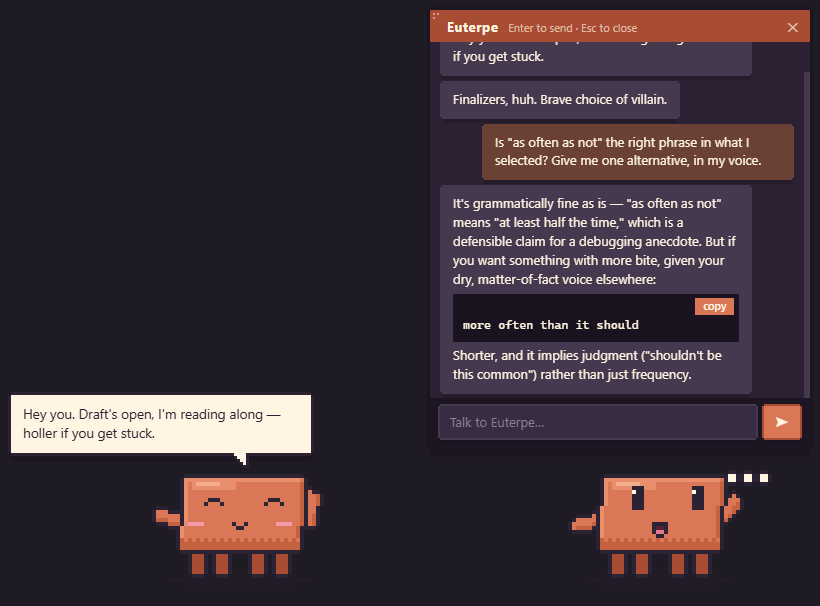
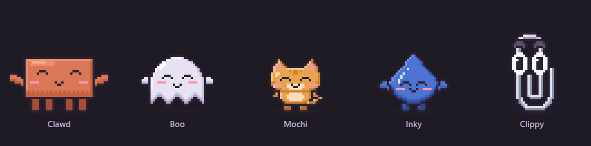

# Euterpe

An AI pair-writing companion for VS Code. Not a ghostwriter — a presence that sits beside you while you write, stays silent while you're in flow, and helps when you're stuck or when you ask.

Writing alone is quiet. Euterpe is a small pixel creature in the corner of your screen, with a mind behind it. It reads along as you write, and keeps its remarks for when they're welcome. It answers when you talk to it, and it gets to know you from one session to the next. Your words stay yours: Euterpe asks questions and makes observations. It rewrites only when you ask, and it changes your file only through a diff you accept.

## Getting started

Euterpe needs a mind, one of:

- **[Claude Code](https://code.claude.com)**, with a Claude subscription or an API key (the default);
- **a ChatGPT Plus or Pro plan**;
- **an API key** for any OpenAI-compatible provider, or a model server on your computer (Ollama, LM Studio);
- **a GitHub Copilot plan**, signed in to Copilot in VS Code.

For the others, switch *Mind* in **Euterpe: Open Settings**: to **OpenAI & others**, then sign in or set your key; or to **GitHub Copilot**, and allow Euterpe when VS Code asks. A local model must support tool calls, with a context of 16K tokens or more.

Then:

1. Open the document you're writing: Markdown, plain text, anything.
2. Click **Euterpe** in the status bar (or run **Euterpe: Start Writing Session**).
3. The first time, Euterpe offers to download its avatar's window runtime (Electron, about 150 MB, once).

Euterpe walks onto your screen, reads its memory and your draft, then says hello. **Euterpe: Check Setup** checks everything a session needs, without starting one.

## Writing together

- **`Ctrl+K Ctrl+E`** (`⌘K ⌘E` on macOS), *Talk to Euterpe*, opens a box at the top of VS Code: type, press Enter, keep writing. The answer appears in the speech bubble. Select a sentence first, and Euterpe knows what "this" means.
- **Click Euterpe's body** for the chat, for a longer back-and-forth.
  - `Esc` closes it and hands the keyboard back to the editor.
  - Suggestions come in code blocks with a **copy** button.
  - Drag the chat's top or left edge to make it bigger.
- **Ask Euterpe to change the file** ("fix that typo", "rewrite this paragraph in the doc"), and the change opens as a diff in place of your text.
  - **✓ Accept** in the diff's title bar applies it, and one undo takes it back. **Reject**, or closing the diff, throws it away.
  - Asking for a suggestion gets a suggestion, not an edit: Euterpe never changes your text unasked, and nothing lands without your click.
- **Notes badge**: the yellow badge by Euterpe's head counts the notes it's holding back (a typo, a repeated word). Click it to hear them.
- **Its own window**: drag Euterpe anywhere, or right-click it for a menu. The window never takes your keyboard, except while the chat is open.
- **It reads along**: it follows you from file to file, sees your selection, and notices when you save, pause, or wander off.
- **Beyond the page**: Euterpe can do what an agent does (read your notes elsewhere, run a command, fact-check on the web, commit the post) **when you ask**. Unasked, it only looks around your workspace and the web.
- **Session menu**: click **Euterpe** in the status bar during a session to talk, end the session (a goodbye first), open Euterpe's memory, or choose a persona, a mascot or a model.
- **Settings**: **Euterpe: Open Settings** (also in the session menu, and on the status bar item's hover) shows everything in one place: the personas to read and pick, the mascots moving, the model, how closely Euterpe reads along.

## Personas and mascots

**Who Euterpe is** is a persona:

- *Cheeky* (the default): teasing, playful, never corporate;
- *Warm*: gentle and encouraging;
- *Editor*: dry, precise, all about clarity;
- *Coach*: momentum over perfection;
- *Drill Sergeant*: yells you to the finish line, funny and never sorry;
- *Your Biggest Fan*: adores every word you write, for the days you need it.

**Euterpe: Choose Persona** switches between them. **New Persona** starts your own from a copy of the current one; it's a Markdown file you can rewrite however you like. You can also ask Euterpe to write one with you. A new persona takes effect at the next session.

**What Euterpe looks like** is a mascot:

- Clawd, the Claude Code mascot (the default);
- *Boo*, a ghost;
- *Mochi*, a cat;
- *Inky*, a drop of ink;
- *Clippy*, a paperclip that would like to help;
- or one of your own.

Clawd only comes with a mind on Claude: it's Claude Code's mascot. On other minds, Inky is the default.

**Euterpe: Choose Mascot** changes it on the spot: one walks off, the other walks in. **Euterpe: Open Settings** shows them all moving, at the size they'll be on your screen. Mascots are small JSON files you can draw and share (**Install Mascot…**). Or ask Euterpe for a new body: it draws one with you, looks at it, and offers it. [The mascot guide](docs/mascots.md) describes the format.

## What it costs

Euterpe takes a short look whenever you pause, mostly served from the prompt cache: at API prices, about $1–2 per hour of writing with Sonnet, the default. On a subscription, a ChatGPT plan or a Copilot plan, the looks count toward your usage limits; a *relaxed* or *light* `euterpe.attention` looks less often.

## Settings

**Euterpe: Open Settings** is the easy way to change them. Underneath, they're ordinary VS Code settings:

| Setting | Default | |
|---|---|---|
| `euterpe.provider` | `claude` | What Euterpe's mind runs on: `claude` (through Claude Code), `openai` (your ChatGPT plan, OpenAI's API, or any OpenAI-compatible one with your key) or `copilot` (the models your GitHub Copilot plan offers in VS Code). |
| `euterpe.model` | *(Sonnet)* | The Claude model Euterpe thinks with: `haiku` (the quickest and cheapest), `sonnet`, `opus` (more thoughtful, and pricier), `fable` (the most thoughtful, and by far the most expensive), each Claude Code's latest of its kind, or any model Claude Code knows (**Choose Model**, which also switches it mid-session). |
| `euterpe.openaiModel` | *(your plan's Sol; GPT-6.1 Sol on OpenAI's API)* | The model on `openai`: one your ChatGPT plan offers; on OpenAI's API `gpt-6.1-sol`, `gpt-6-astra`, `gpt-6-luna`, or any model it knows. Another provider has no default: name one. |
| `euterpe.openaiBaseUrl` | *(your ChatGPT plan)* | The OpenAI-compatible API, by its base URL: `https://api.openai.com/v1` (OpenAI's API), `https://openrouter.ai/api/v1`, `http://localhost:11434/v1` (Ollama)… Its key is set with **Euterpe: Set API Key**; the plan's sign-in with **Euterpe: Sign In with ChatGPT**. User settings only. |
| `euterpe.copilotModel` | *(Copilot's newest GPT Terra)* | The model on `copilot`, by its id: one Copilot offers you (**Choose Model** lists them). |
| `euterpe.effort` | `low` | Reasoning effort (`low`, `medium`, `high` or `xhigh`), on Claude and OpenAI-compatible APIs. Lower = snappier chat replies and cheaper looks. |
| `euterpe.attention` | `close` | How closely Euterpe reads along: `close`, `relaxed` or `light` — fewer looks, less of your usage. |
| `euterpe.persona` | `cheeky` | Who Euterpe is: `cheeky`, `warm`, `editor`, `coach`, `drill-sergeant`, `fan`, or one of yours in `~/.euterpe/personas/` (**Choose Persona**). |
| `euterpe.mascot` | `clawd` | Euterpe's body: `clawd` (on Claude; Inky otherwise), `boo`, `mochi`, `inky`, `clippy`, or one of yours in `~/.euterpe/mascots/` (**Choose Mascot**). |
| `euterpe.avatarScale` | `4` | On-screen size of Euterpe's pixels (2–6). 3 is a quieter presence. |
| `euterpe.followActiveEditor` | `true` | Follow you to whatever document you switch to. When off, Euterpe stays with the document the session started on. |
| `euterpe.claudeConfigDir` | *(inherited)* | Claude Code config folder for the mind (`CLAUDE_CONFIG_DIR`): which login pays, which settings it reads. Useful if you keep several Claude Code setups, say a personal subscription and a work API key. |
| `euterpe.homeDir` | `~/.euterpe` | Euterpe's home: memory, your personas and mascots, the mind's working directory. A synced folder shares them between machines. User settings only. |
| `euterpe.personaFile` | *(none)* | A persona Markdown file anywhere on disk, instead of `euterpe.persona`. User settings only. |
| `euterpe.claudePath` | *(automatic)* | The `claude` executable. Found by default on PATH, where the native installer, Homebrew, WinGet and npm put it, or inside the Claude Code VS Code extension. |
| `euterpe.electronPath` | *(downloaded)* | An Electron executable for the avatar's window, for machines that can't download it. |
| `euterpe.debugMind` | `false` | Opens an **Euterpe Mind** terminal with a live transcript (perceptions, replies, tool calls, token usage) and logs the raw traffic. |

## Building from source

See [CONTRIBUTING.md](CONTRIBUTING.md).

## Credits

- Euterpe is an independent project, not made by or affiliated with Anthropic.
- Clawd is the mascot of Anthropic's Claude Code; this pixel-art rendition is drawn from scratch in code.
- Clippy is Microsoft's Office Assistant; this pixel-art rendition is drawn from scratch.
- The acting system (acted expression changes, takes, springs, key-view turns, model sheets) follows [ClaudeAnimationBase](https://github.com/JohnHeibel/ClaudeAnimationBase) by John Heibel (MIT).
- MIT licensed: see [LICENSE](LICENSE).
